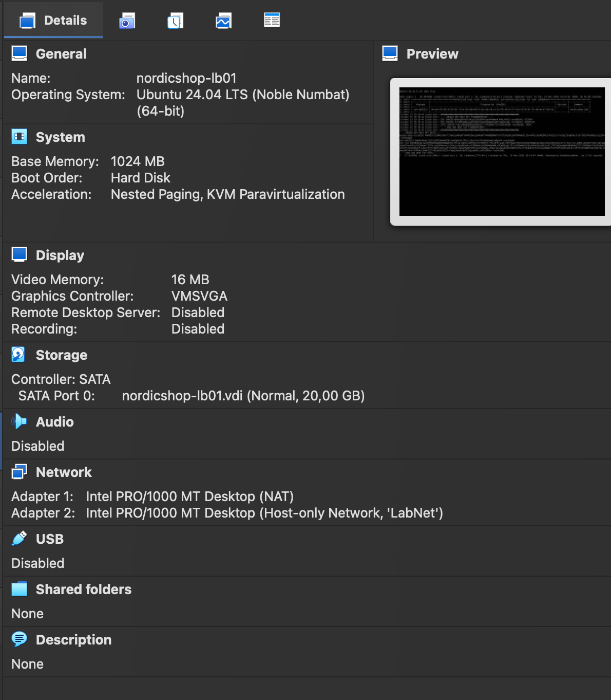
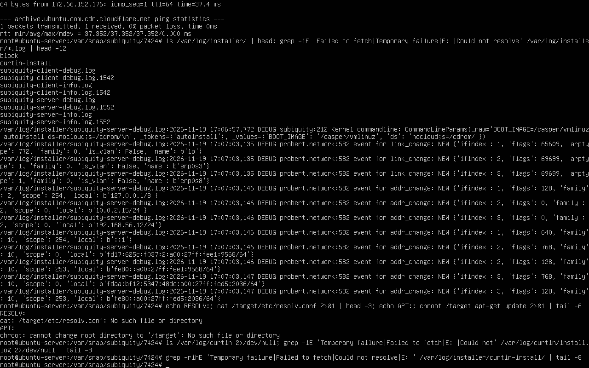
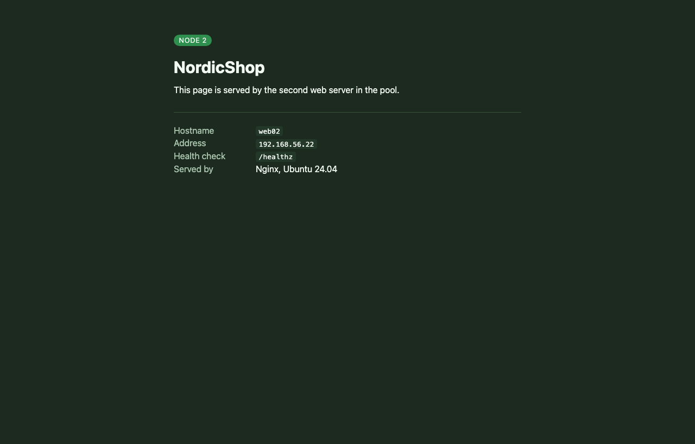
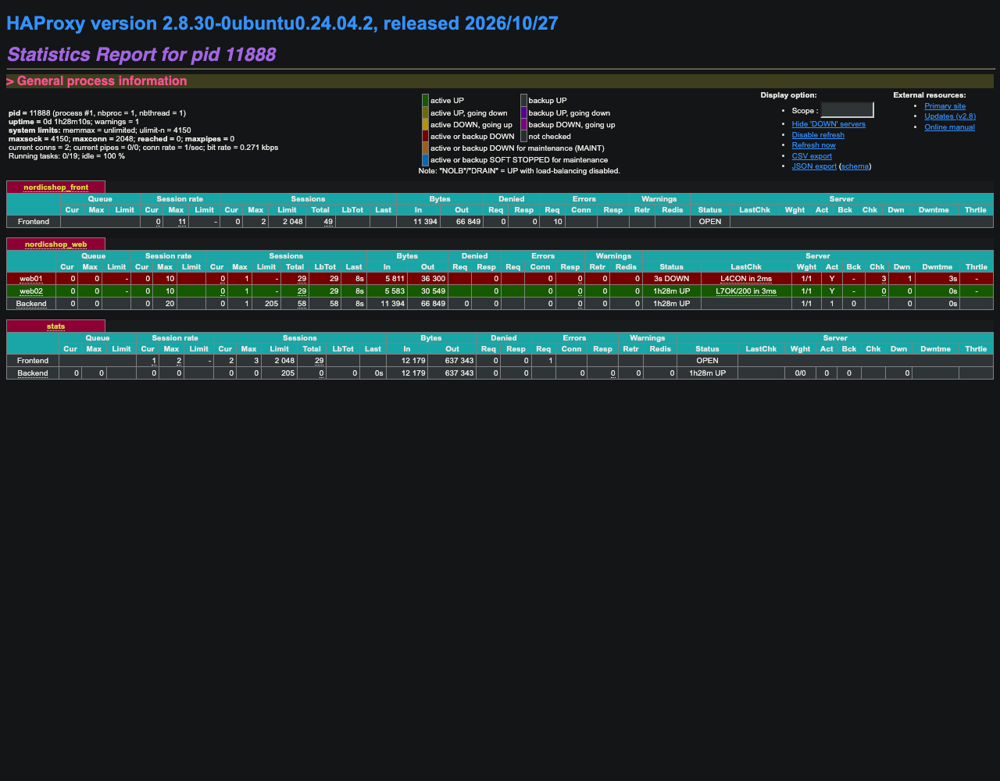
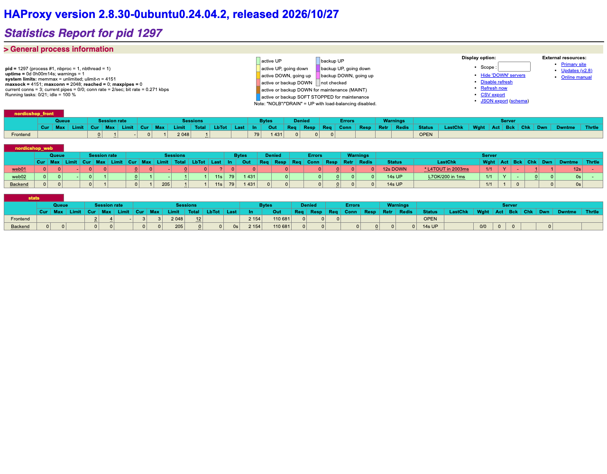
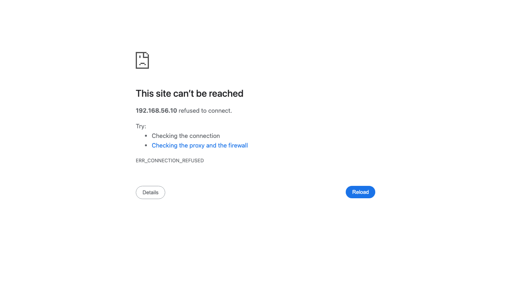
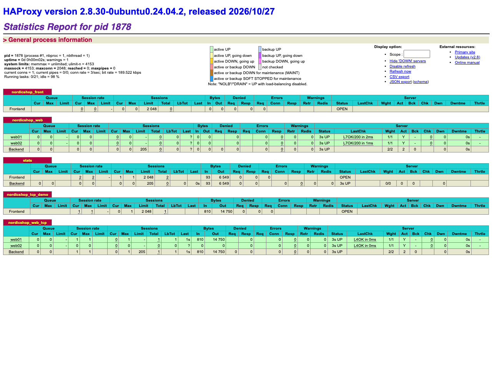

# NordicShop — High Availability & Load Balancing Lab

**A practical case study in load balancing, health monitoring, fault detection, and infrastructure reliability.**

NordicShop is an online shop. It used to run on one server, and when that server had a
bad day, the shop disappeared. I rebuilt that shop as four virtual machines on my own
laptop, put a load balancer in front of two web servers, and then broke it on purpose five
times to see exactly what a customer would experience. Everything below is what actually
happened, in the order it happened, with screenshots from the running lab beside the step
they belong to.

I did not deploy anything to Azure. This is the same design built with the closest
on-premises tools, so the failures are real instead of described. The Azure comparison in
section 7 is a translation of this lab, not a measurement of the managed service.

### The words I use, in plain English

| Word | What it means here |
| --- | --- |
| Server | A computer that answers requests. Here, a virtual machine running on my laptop. |
| Load balancer | The front door. It takes every customer request and hands it to a server that is free. |
| Backend | A server behind the front door. NordicShop has two of them. |
| Health check | A small test the front door runs every couple of seconds: "are you still able to answer?" |
| Single point of failure | One part that, if it stops, takes the whole service down with it. |
| Firewall rule | A rule that says who is allowed to talk to which port on a machine. |

If you have never worked in IT, the analogy that carries this whole project is a
supermarket. One checkout till means one queue and one breakdown stops all sales. Two
tills help, but only if somebody stands at the front and sends each shopper to a free
one. And that person has to be able to look over and see whether a till is actually open,
not just switched on.

## 1. The business problem — what was happening at NordicShop?

NordicShop sells online. Customers visit the website, browse products, check prices and
place orders. At first one web server did all of that, and it was fine while the shop was
small.

As customer activity grew, the infrastructure started to struggle. During busy periods the
site was slow. On other occasions it went down completely because the server stopped
responding. For the business that meant four things:

- Customers could not reach the shop at all.
- Some of them gave up halfway through a purchase.
- Sales were lost on days the shop was busiest.
- The IT team had no second machine to take over when the first one failed.

The infrastructure team was asked to investigate and build something that keeps serving
customers even when one web server becomes unavailable. That is the job this repository
documents.

## 2. What I found wrong

The investigation came down to three weaknesses, and they are worth separating because
each one needs a different fix.

**Problem 1 — the website lived on one server.** If that machine had an operating system
problem, a service crash or an unexpected shutdown, the site was gone. The root cause was
simply that there was nothing to fail over to. The fix: a second web server.

**Problem 2 — nothing distributed the traffic.** Buying a second server does not help on
its own. Customers type one address, and something has to decide which of the two machines
answers each of them. The root cause was that no component owned that decision. The fix: a
load balancer in front of both servers.

**Problem 3 — nothing checked whether a server was actually working.** A machine can be
powered on, fans spinning, while its web service has stopped. Without monitoring, requests
keep being sent to a server that cannot answer them. The root cause was the absence of any
continuous check. The fix: health checks, so the front door notices and stops using a
broken server.

## 3. The design I built

```
        NordicShop customer
        client01  192.168.56.31
                 |
                 v
        lb01  192.168.56.10        HAProxy, port 80 (and a dashboard on 8404)
             /        \
            v          v
   web01 192.168.56.21   web02 192.168.56.22
        Nginx :80         Nginx :80
             \          /
              GET /healthz, every 2 seconds
```

| Component | What it is for |
| --- | --- |
| `client01` | Plays the customer. Sends the requests and records what came back. |
| `lb01` | The front door. Receives every request and picks a backend. |
| `web01` | First copy of the NordicShop website. |
| `web02` | Second copy of the NordicShop website. |

Customers use one address, `http://192.168.56.10`, and never learn that two servers exist
behind it. HAProxy hands each request to an available server, and if one becomes
unavailable it sends new requests to the other one.

All four machines are Ubuntu Server 24.04.5 LTS on VirtualBox 7.2.14, one vCPU, 1024 MB of
memory and a 20 GB disk each, which is enough to be teachable and small enough to throw
away. Each machine has two network cards: one that reaches the internet so packages can be
installed, and one on a private network, `LabNet` on `192.168.56.0/24`, that carries all
lab traffic on static addresses.

## 4. Building it, phase by phase

Each phase below follows the same shape: the business situation, what had to be done, the
steps, and what I saw when it was done. The screenshots are the real thing, taken from the
machines at that stage.

### Phase 1 — Preparing the infrastructure

**The situation:** NordicShop needs more server capacity, and a separate component that
manages incoming traffic.

**The work:** build the four virtual machines and give them fixed addresses.

#### Step 1 — Create the virtual machines

Four Ubuntu Server guests in VirtualBox: `lb01`, `web01`, `web02` and `client01`. This is
the host's own view of them, cropped to the lab machines because the same VirtualBox
library holds other work that has nothing to do with this project.


#### Step 2 — Give each machine a fixed address

| Machine | Address | Why |
| --- | --- | --- |
| `lb01` | 192.168.56.10 | The single address customers use |
| `web01` | 192.168.56.21 | First backend, must be reachable from `lb01` |
| `web02` | 192.168.56.22 | Second backend, same reason |
| `client01` | 192.168.56.31 | Sends the test traffic |

Fixed addresses matter because the balancer has to reach the same two machines every time.
With DHCP, an address could move to a different machine overnight and the balancer's
configuration would quietly point at nothing. I set these in netplan, so they survive a
reboot.

**What each machine actually holds.** The panels below are VirtualBox's details view for
each guest: name, operating system, memory, disk, network cards and a live console
preview.

`lb01` is the only machine facing the customer. It has no web content of its own, which is
the point of Incident 4: when HAProxy stops here, the shop is gone even though both
backends are perfectly healthy.



`web01` serves the shop page and the `/healthz` endpoint the balancer probes. The firewall
on it accepts port 80 from `192.168.56.10` only, so neither the client nor my Mac can reach
it directly and skip the balancer. That restriction is what makes Incident 2 possible to
test honestly.


`web02` is identical in every way that matters to a request. It prints NODE 2 instead of
NODE 1, and that difference is how a screenshot can prove which machine answered.


`client01` is the customer's view. It runs nothing but SSH, `curl` and `jq`, so every
result in this repository is a client result and not something measured from inside the
infrastructure.


#### Step 3 — Install the operating system

I provisioned the guests with a cloud-init seed so each install was identical. Two came up
cleanly and dropped to a login prompt.

`lb01` finished at 18:19:44 and landed on its own hostname, which is how I knew the
installer had used the identity I gave it:


`client01` did the same at 18:38:06:


`web01` and `web02` did not. Both stopped on the same line, `run_unattended_upgrades`,
which runs `apt-get dist-upgrade` inside the new system and prints nothing at all while it
runs, so a stuck install looks exactly like a slow one.


#### What went wrong installing, and how I got past it

This cost me the most time in the whole build, so it stays in the order it happened.

The first attempt failed loudly: the installer worked through network, mirror and locale,
then stopped with

```
curtin command in-target returned non-zero exit status 1
An error occurred. Press enter to start a shell
```

I took the shell and checked the obvious thing first, the network. The archive answered a
ping in 37 ms, so connectivity was never the problem. What the shell did show was that
`/etc/resolv.conf` named no server, and that `/target` had already been torn down, so the
failing `apt-get update` could not be re-run to read its own error.



The cause was the resolver. The installer resolves through systemd-resolved's stub on
`127.0.0.53`, and inside the target chroot there is nothing behind that stub, so apt could
not resolve the archive even though the installer environment could. The fix was to write a
real resolver before the target gets configured, so curtin copies a working one in:

```yaml
early-commands:
  - sh -c 'printf "nameserver 10.0.2.3\nnameserver 1.1.1.1\n" > /etc/resolv.conf'
```

`10.0.2.3` is VirtualBox's own NAT DNS service. With that in place the same stage completed
and curtin moved on to packages, kernel and bootloader.

The second attempt failed quietly, which was worse. Three guests sat in the final stage for
between 20 and 50 minutes with no error, and the host made it look like work was happening:
`VBoxHeadless` was holding 112% of a CPU. The disk disagreed. The VDI was 3927 MB, and it
was still 3927 MB seventy-five seconds later, so nothing was being written to it.


I never pinned that one down conclusively, and
`troubleshooting/install-autoinstall-failures.md` says so instead of inventing a cause.
What I did instead was use what the installer had already produced: kernel, bootloader,
cloud-init and OpenSSH were all on disk. So I powered each guest off, detached both ISO
images, made the disk the first boot device and started it again.

```bash
VBoxManage controlvm nordicshop-lb01 poweroff
VBoxManage storageattach nordicshop-lb01 --storagectl SATA --port 1 --device 0 \
  --type dvddrive --medium none
VBoxManage storageattach nordicshop-lb01 --storagectl SATA --port 2 --device 0 \
  --type dvddrive --medium none
VBoxManage modifyvm nordicshop-lb01 --boot1 disk --boot2 none
VBoxManage startvm nordicshop-lb01 --type headless
```

That worked on all of them. Both network cards came up with their static addresses,
`dpkg --audit` printed nothing, and key authentication worked.

**What this phase produced:** four virtual machines that boot, hold their addresses and can
reach each other on the lab network.

### Phase 2 — Putting the shop on two servers

**The situation:** the shop still depends on one server. If that one fails, customers lose
access.

**The work:** install Nginx on both web servers and give each one a page that says which
machine answered.

#### Step 1 — Install Nginx on both machines

```bash
sudo apt update
sudo apt install nginx -y
sudo systemctl enable --now nginx
```

`enable --now` matters more than it looks. It starts Nginx and also makes sure it comes
back after a reboot, which is the difference between a lab that survives the night and one
that quietly dies.

#### Step 2 — Give each server its own identity

Both machines serve the same shop page, with the node name and address baked into it:

```
Welcome to NordicShop
Your online shopping destination.
Request handled by: WEB01
Server IP: 192.168.56.21
```

`web02` serves the same text with NODE 2 and `192.168.56.22`. Each response also carries
`X-Web-Node: web01|web02` and `Cache-Control: no-store`, so a cached page can never be
mistaken for proof that a particular machine answered. Without that identity, two servers
behind a balancer look like one server, and you cannot tell whether the balancer is doing
anything at all.

#### Step 3 — Add an endpoint the balancer can test

Both servers answer `/healthz` with `ok web01` or `ok web02`. That endpoint is deliberately
tiny: it returns nothing from disk and does no database work, so if it answers, the web
server itself is alive. A health endpoint that depends on three other systems tells you
about those systems, not about the machine you are testing.

#### Step 4 — Prove both servers answer on their own

From another machine on the lab network:

```bash
curl http://192.168.56.21
curl http://192.168.56.22
curl http://192.168.56.21/healthz
curl http://192.168.56.22/healthz
```

Both pages came back, each naming its own machine, and both health endpoints answered.

#### Step 5 — Check the firewall boundary in both directions

`web01` and `web02` accept port 80 only from `192.168.56.10`. The point is to make sure
customers really do go through the front door and cannot walk around it. When I tested the
blocked direction from the client, the connection timed out at 5.00 s rather than being
refused, which is what a DROP rule looks like: silence, not a rejection.

### Phase 3 — Adding the load balancer

**The situation:** two working web servers, and still nothing to decide which one answers.

**The work:** install HAProxy on `lb01` and put both servers in a pool behind it.

#### Step 1 — Install it

```bash
sudo apt update
sudo apt install haproxy -y
```

#### Step 2 — Open the front door

HAProxy listens on `192.168.56.10:80`, and only there. It is not bound to `0.0.0.0`,
because the NAT interface exists for package downloads and has no business accepting
customer traffic. This single address is now the whole shop as far as the outside world is
concerned.

#### Step 3 — Build the pool

Both backends go into one backend block, `nordicshop_web`:

- `web01` at `192.168.56.21:80`
- `web02` at `192.168.56.22:80`

Distribution is `balance roundrobin`, so requests take turns. The mode is `http` rather
than `tcp` because HTTP mode can ask for `/healthz` and check for a `200`, instead of only
proving that something accepts a connection. That choice later turned out to prevent
keep-alive from pinning one customer to one server, which is Incident 5.

#### Step 4 — Teach it what "working" means

`option httpchk GET /healthz` plus `check` on each server line. Every two seconds HAProxy
asks both machines the same question. A server that fails the check is marked DOWN and
stops receiving new requests. `option redispatch` is also on, which lets HAProxy retry a
request that landed on a server which just died against the other one.

#### Step 5 — Validate before trusting it

```bash
sudo haproxy -c -f /etc/haproxy/haproxy.cfg
```

A valid config only means the file parses. Incident 3 exists because a valid configuration
can still describe a machine that is not there, so the real check is the dashboard:


Both servers green, `Status UP`, `LastChk L7OK/200`, equal weight on `nordicshop_web`. On
port 8404 HAProxy serves its own statistics page, which became the window I watched during
every incident. That bottom line is the state I expect before I break anything.

### Phase 4 — Checking it from the customer's side

**The situation:** the new infrastructure exists. Before anyone relies on it, it has to be
shown working from where the customer stands.

The customer only ever runs one command:

```bash
curl http://192.168.56.10
```

Then the same thing ten times over, to see whether both machines are really taking a share:

```bash
for i in {1..10}; do curl -s http://192.168.56.10 | grep 'Server IP'; done
```

Two separate requests through the balancer, one round-robin step apart, land on different
machines:


`NODE 1`, `web01`, `192.168.56.21`.



`NODE 2`, `web02`, `192.168.56.22`.

Same URL, different server, and the client never chose. A run of twenty requests split
10/10, both servers `UP`, `check=L7OK`, `code=200`.

## 5. Incidents — what happens when it breaks

Building something that works is the easy half. The useful half is knowing how it behaves
when a part fails. So I ran five controlled failures, each with samplers recording the
customer's view and the pool's view at the same moment, and wrote each one up in the same
shape:

1. **Incident** — what happened to NordicShop?
2. **Investigation** — what caused it?
3. **Action** — how did I reproduce or fix it?
4. **Result** — how did the infrastructure respond?
5. **Lesson** — what does this mean for reliability?

| # | What I broke | Detection | Customer impact |
| --- | --- | --- | --- |
| 1 | Stopped Nginx on `web01` | **~1.5 s** | 0 of 120 requests failed (98 to web02, 22 to web01) |
| 2 | Blocked `lb01` to `web01:80` with a firewall rule | **~9.3 s** | 3 of 80 requests failed |
| 3 | Pointed `web01`'s health check at port 8080 | **~2.4 s** after reload | 0 of 60 requests failed, capacity halved |
| 4 | Stopped the load balancer itself | no detection, **~34 s outage** | 33 of 33 requests failed |
| 5 | Sent keep-alive traffic through a Layer 4 frontend | n/a | none: 10 of 10 requests pinned to one node |

### Incident 1 — WEB01 stops responding

**Incident.** `web01` suddenly stopped answering HTTP requests. Customers were still
visiting the shop, but the first backend could no longer process anything.

**Investigation.** The Nginx service on `web01` had been stopped. The question I wanted
answered was whether HAProxy would notice and move traffic to `web02` with no help from me.

**Action.**

```bash
sudo systemctl stop nginx
```

while the client kept sending requests through the balancer.

**Result.** HAProxy detected the failure and marked `web01` DOWN. New traffic went to
`web02`. Customers continued to shop.

| Measurement | Result |
| --- | --- |
| Detection time | about 1.5 seconds |
| Total requests | 120 |
| Failed requests | 0 |
| Served by web01 | 22 |
| Served by web02 | 98 |

This is the one failure I caught in a screenshot while it was happening. I stopped Nginx,
waited three seconds, captured the stats page, then started it again:



`web01` is red with `L4CON in 2ms`, a downtime timer of three seconds and a growing queue;
`web02` is untouched and still `UP`. The frontend row stays `OPEN` throughout, which is the
whole point: the pool lost half its capacity and the customer saw `200`s.

**Recovery.**

```bash
sudo systemctl start nginx
```

No reload, no config change. HAProxy logged `L7OK/200` and the node was `UP` about a second
later. The reason no customer saw an error is `option redispatch`: the 22 requests that had
been assigned to the dead node were retried against `web02`.

**Lesson.** A backend failure does not have to become a website outage when another healthy
server is available and the balancer is configured to use it. It also taught me that a
monitoring system watching HTTP status codes would have missed this incident completely,
because every response was a `200`.

### Incident 2 — LB01 cannot talk to WEB01

**Incident.** `web01` was running fine, but NordicShop's balancer could no longer reach it.

**Investigation.** A firewall rule was blocking HTTP between the two machines. I wanted to
know whether the symptom was the web server or the path to it, because those look the same
from the outside.

**Action.** I added a `ufw` rule on `web01` denying port 80 from `192.168.56.10`, then
watched the health checks and kept sending customer requests.

**Result.** `web01` stayed up and Nginx kept serving locally. HAProxy could not reach it,
the checks failed, and the node was eventually marked DOWN. Some customers were affected
while detection was in progress.

| Measurement | Result |
| --- | --- |
| Detection time | about 9.3 seconds |
| Total requests | 80 |
| Failed requests | 3 |
| Health-check result | Layer 4 timeout |

The dashboard caught this one too. `web01` is red with `L4TOUT in 2003ms` — the check ran
to its full two-second timeout before the node was removed — while `web02` stayed green and
absorbed the traffic:


That row is the fingerprint. Incident 1 said `L4CON in 2ms`, because something answered with
a refusal; here nothing answered at all, so the check burned its whole timeout before
failing.

**Recovery.** Remove the rule:

```bash
sudo ufw delete deny from 192.168.56.10 to 192.168.56.21 port 80 proto tcp
```

The path came back and HAProxy found it on its own about 3.5 seconds later, with no HAProxy
or Nginx restart.

**Lesson.** A server can be perfectly healthy and still unavailable to an application,
because of the network between them. Dropped packets also look nothing like a refused
connection: the same pool state, but detection took 9.3 seconds instead of 1.5, and
customers saw three requests hang until their own timeout.

### Incident 3 — A healthy server reported as unavailable

**Incident.** `web01` was working correctly, and HAProxy insisted it was down.

**Investigation.** The health check was aimed at port 8080. Nginx listens on 80.

**Action.** I pointed `web01`'s check at 8080, reloaded, and watched the dashboard.

**Result.** Nginx kept serving `200` on port 80. Health checks failed, `web01` went DOWN,
and customer requests continued through `web02` without an error.

| Measurement | Result |
| --- | --- |
| Detection time | about 2.4 seconds after reload |
| Total requests | 60 |
| Failed requests | 0 |
| Backend capacity | halved |

`web01` is red and out of the pool, exactly as it was in Incident 2, and yet the same
machine answered `200` on port 80 every time I asked it, from `lb01` and from itself:



The row says `L4TOUT in 2003ms` against a server whose Nginx never stopped, because the
check was knocking on port 8080 where nothing listens.

**Recovery.** Put the correct configuration back and reload:

```bash
sudo cp /tmp/inc3-good.cfg /etc/haproxy/haproxy.cfg
sudo systemctl reload haproxy
```

The web server itself never needed restarting, which was the point: only the observer was
wrong.

**Lesson.** Monitoring is only useful when it is configured correctly. `haproxy -c` had
already said the file was valid, and it was: a valid configuration can still describe a
machine that does not exist. Configuration validation is not behavioural validation.

### Incident 4 — The load balancer stops

**Incident.** Customers could no longer reach the shop at its normal address.

**Investigation.** The HAProxy service on `lb01` had been stopped. Both backends were
perfectly healthy, and it made no difference at all.

**Action.**

```bash
sudo systemctl stop haproxy
```

with the client still sending requests.

**Result.** `web01` and `web02` stayed healthy. `lb01` stopped accepting requests. Every
single test request failed.

| Measurement | Result |
| --- | --- |
| Total requests | 33 |
| Failed requests | 33 |
| Outage duration | about 34 seconds |
| Backend servers | both healthy |
| Load balancer | unavailable |

A plain headless navigation still will not save the frame: Chrome reports
`net::ERR_CONNECTION_REFUSED` and exits without writing an image. Captured through the
browser's debugging protocol instead, the outage looks like this:



That is the whole customer experience for those seconds: the address is correct, the
connection is refused, and there is no second address to try.

**Recovery.** Start it again:

```bash
sudo systemctl start haproxy
```

That restores service in seconds, but a recovery is not a fix, and the report says so.

**What would actually fix it.** Two load balancers and one shared virtual address, with
keepalived and VRRP electing which one is active. That design is written up in
`troubleshooting/incident-04-load-balancer-failure.md` and it was **not built**. A
four-VM lab with a single client cannot honestly demonstrate an election, and I would
rather say that than pretend otherwise.

**Lesson.** Backend redundancy is not high availability. All of the availability work in
this lab sat below the one component that had none.

### Incident 5 — Uneven traffic distribution

**Incident.** During one of the tests the two backends did not receive the share of traffic
I expected.

**Investigation.** Connection-level balancing in Layer 4 behaves differently from
request-level balancing. I compared them with the same client and the same load.

**Action.** I ran ten requests through the HTTP frontend, then ten through a temporary
`mode tcp` frontend, keeping the connection alive.

**Result.**

| Measurement | Result |
| --- | --- |
| Total requests | 10 |
| HTTP-mode distribution | 5 and 5 |
| Layer 4 distribution | 10 and 0 |
| Customer errors | 0 |

The Layer 4 run put all ten requests on `web01` because they shared one persistent
connection, and a Layer 4 balancer chooses per connection. The counters said so: `sessions=1`
and `req_tot` blank, because it cannot count requests it never looks inside.

The temporary frontend is still in the dashboard while the test runs, and it reports the
ten requests as **one** unit of load:



`nordicshop_web_tcp` shows `web01` with `sessions=1`, `web02` with `0`, and blank request
columns: a Layer 4 balancer cannot count requests inside a connection it never looks into.

**Recovery.** Remove the temporary frontend and restore `balance roundrobin`:

```bash
sudo cp /tmp/inc5-base.cfg /etc/haproxy/haproxy.cfg && sudo systemctl reload haproxy
```

**Lesson.** Traffic distribution depends on the balancing method and on how clients
connect. Two backend servers do not guarantee an equal workload. The dashboard looked
perfectly healthy while one node did all the work, which is the kind of thing that only
shows up when you compare session counts against request counts.

### What the five incidents have in common

The same broken service produced five completely different fingerprints. A stopped process
failed in 1.5 seconds and was masked from customers. A dropped packet took 9.3 seconds and
was not. A wrong port removed a healthy node in 2.4 seconds while the config passed every
check. A dead balancer produced a total outage with two perfectly good servers behind it.
And a healthy pair of servers can still do wildly unequal work depending on how you count.

## 6. What the project demonstrated

| Original problem | Implemented solution or finding |
| --- | --- |
| Single backend server | Two Nginx web servers |
| No traffic distribution | HAProxy load balancer |
| No automatic backend health detection | HTTP health checks on `/healthz` |
| Backend server failure | New traffic redirected to a healthy backend |
| Network connectivity failure | Detection through health checks |
| Load balancer as a single point of failure | Identified; secondary load balancer design documented |
| Uneven traffic distribution | Compared Layer 4 and HTTP balancing behaviour |

## 7. How this relates to Microsoft Azure

I built this locally, but the concepts are the ones that show up in Azure networking, and
this mapping is what I would carry into a design review.

| Local component | Azure concept |
| --- | --- |
| HAProxy | Azure Load Balancer (similar traffic-distribution role) |
| Nginx on `web01` and `web02` | Backend pool virtual machines |
| `/healthz` endpoint | Load balancer health probe |
| UFW firewall rules | Network Security Group rules |
| HAProxy frontend address | Load balancer frontend IP |
| Two backends | Redundant backend infrastructure |

This is a conceptual mapping, not a claim that the two behave identically. Azure Load
Balancer is a managed service, and none of the timings here are Azure performance numbers.

**What Azure removes for you:**

1. The balancer as a single point of failure. No VM to stop, no keepalived to build, a
   zone-redundant frontend with a 99.99% SLA on the Standard SKU.
2. VIP failover engineering. The 34-second total outage in Incident 4 has no equivalent.
3. Patching and hardening a balancer operating system.
4. Probe state lost across reloads.
5. Capacity planning for the balancer host.

**What Azure does not remove:**

1. Probe misconfiguration (Incident 3). The portal will happily accept a probe port where
   nothing listens.
2. NSG priority-ordering mistakes (Incident 2): silent drops, first match wins, rules on
   the subnet overriding rules on the NIC.
3. Backend single points of failure. A one-VM pool is not highly available because the
   front door is.
4. Request-level retry (Incident 1). Azure Load Balancer is flow-based and cannot
   redispatch a request the way HAProxy did; my zero-error result was a Layer 7 feature.
5. Fast detection. The probe interval floor is 5 seconds, so the same failure takes about
   10 seconds to notice at threshold 2, against the 1.5 measured here. Defaults make it 30.
6. Traffic imbalance (Incident 5). 5-tuple hashing and Client IP persistence are the same
   trade-offs as `mode tcp` and `balance source`, and Layer 4 metrics count flows, not
   requests.

In short: the managed service takes over the availability of the balancer itself and leaves
you owning the probe, the firewall rules, the pool and the balancing key. Those four are
exactly what the five incidents are about.

## 8. What I took away from it

The biggest lesson was the difference between having more than one server and having a
highly available service. At the start the lab worked because everything was running.
Deliberately breaking it showed me how each component contributes to whether the shop is
reachable at all.

What I actually practised here:

- Building and connecting four virtual machines and giving them stable addresses.
- Provisioning Ubuntu Server unattended, and recovering when the installer failed.
- Deploying Nginx and making two servers distinguishable.
- Configuring HAProxy, a pool, round-robin and HTTP health checks.
- Controlling access with firewall rules, and proving the boundary from both sides.
- Simulating process, network, configuration and load-balancer failures.
- Investigating availability from logs, counters and a live dashboard.
- Identifying single points of failure, and saying plainly which ones remain.
- Relating each local component to its Azure counterpart.

Infrastructure engineering is not only about building systems that work. It is about
understanding what happens when they stop working.

## 9. Scope and limitations

- The project was built on VirtualBox, not deployed to Azure.
- The load balancer is a single HAProxy instance, and that is the largest remaining risk.
- Two Nginx backend servers, no database, no sessions: the nodes are deliberately
  stateless.
- Five failure scenarios were tested and documented.
- Keepalived and VRRP are documented as a proposed improvement, not implemented or tested.
- Every incident was captured visually, either from the dashboard mid-failure or, for the
  total outage, from the browser's own error page; the rest of the evidence is measured
  terminal output.
- This is a learning laboratory, not a production-ready architecture.

The objective was to demonstrate practical understanding of load balancing, health
monitoring, fault detection, network security and infrastructure reliability through
hands-on failure testing, and to be honest about the parts that remained unbuilt.

## Appendix — where everything lives

### The build, phase by phase

| File | Contents |
| --- | --- |
| `documentation/phase-1-environment-assessment.md` | Host capacity, VirtualBox and VT-x checks, VM sizing |
| `documentation/phase-2-network.md` | VM creation, cloud-init, static addressing, ping matrix |
| `documentation/phase-3-web-tier.md` | Nginx deployment, node identity, firewall boundary |
| `documentation/phase-4-load-balancer.md` | HAProxy config, probes, algorithm choice, distribution evidence |
| `documentation/phase-5-azure-mapping.md` | The lab translated into Azure terms, incident by incident |
| `architecture/architecture-diagram.md` | Traffic paths, failure domains, what is redundant and what is not |
| `architecture/ip-addressing-plan.md` | Full address plan, netplan, port table, Azure overlay |

### The incidents

| File | Incident |
| --- | --- |
| `troubleshooting/incident-01-backend-failure.md` | Process stopped: fast failure, redispatch, 1.5 s |
| `troubleshooting/incident-02-network-failure.md` | Path blocked: silent drop, 9.3 s, customer timeouts |
| `troubleshooting/incident-03-health-check-port.md` | Wrong probe port: healthy node removed, 2.4 s |
| `troubleshooting/incident-04-load-balancer-failure.md` | Balancer stopped: total outage, keepalived/VRRP design |
| `troubleshooting/incident-05-uneven-distribution.md` | Keep-alive pinning, `balance source`, why counters disagree |
| `troubleshooting/install-autoinstall-failures.md` | Five provisioning failures and how I got past each |

### Configuration and scripts

| Path | Contents |
| --- | --- |
| `configuration/haproxy/haproxy.cfg` | Frontend, backend, probe, timeouts, stats listener |
| `configuration/nginx/web01-*`, `web02-*` | Server blocks and pages for both nodes |
| `configuration/autoinstall/user-data.tmpl`, `meta-data.tmpl` | cloud-init NoCloud templates |
| `scripts/rebuild-lab-vms.sh` | Create the four VMs (prints a plan unless `CONFIRM=yes`) |
| `scripts/install-guest.sh`, `finish-guest.sh` | Seed ISO, autoinstall, then switch to disk boot |
| `scripts/deploy-nginx.sh`, `deploy-haproxy.sh` | Install the configs, with a timestamped backup |
| `scripts/verify-web-tier.sh`, `verify-load-balancing.sh` | Firewall boundary, then distribution |
| `scripts/probe-frontend.sh`, `watch-pool*.sh` | The samplers behind every incident timeline |

### Rebuilding it yourself

Prerequisites: VirtualBox 7.x with a host-only network `LabNet` on `192.168.56.0/24`, an
Ubuntu Server 24.04 live ISO (expected at
`~/Downloads/ubuntu-24.04.5-live-server-amd64.iso`, override with `ISO=`), about 4 GB of RAM
and 80 GB of disk, and a gitignored `.secrets/` holding the lab account details and key.

```bash
CONFIRM=yes BACKUP=yes ./scripts/rebuild-lab-vms.sh
./scripts/install-guest.sh lb01 192.168.56.10    # then web01 .21, web02 .22, client01 .31
./scripts/finish-guest.sh  lb01 192.168.56.10    # same order
./scripts/deploy-nginx.sh web01 && ./scripts/deploy-nginx.sh web02
./scripts/deploy-haproxy.sh
./scripts/verify-web-tier.sh && ./scripts/verify-load-balancing.sh 20
```

Expected result: the firewall matrix passes in both directions, and the 20 requests split
10/10 with both servers `UP`, `check=L7OK`, `code=200`.

### Screenshots

`screenshots/` holds real captures only: the four VMs in VirtualBox Manager, each guest's
details panel, a console for all four installs plus the stall and the recovery shell, both
web nodes answering, the healthy pool, and all five incidents caught as they happened. The
browser frames were taken with headless Chrome pointed at `192.168.56.10`, except the total
outage, where the balancer had nothing to answer with and the frame came from Chrome's own
error page; the console frames are from the VirtualBox display. The frames for incidents 2
to 5 were taken while re-running each fault to confirm it still behaves as documented, so
the counters in them belong to that run, not to the request totals in the tables. Nothing
was recreated.

---

Built and measured on macOS with VirtualBox, November 2026. Every command, counter and
timestamp in these documents came from the running lab; where something was not tested,
the document says so.
