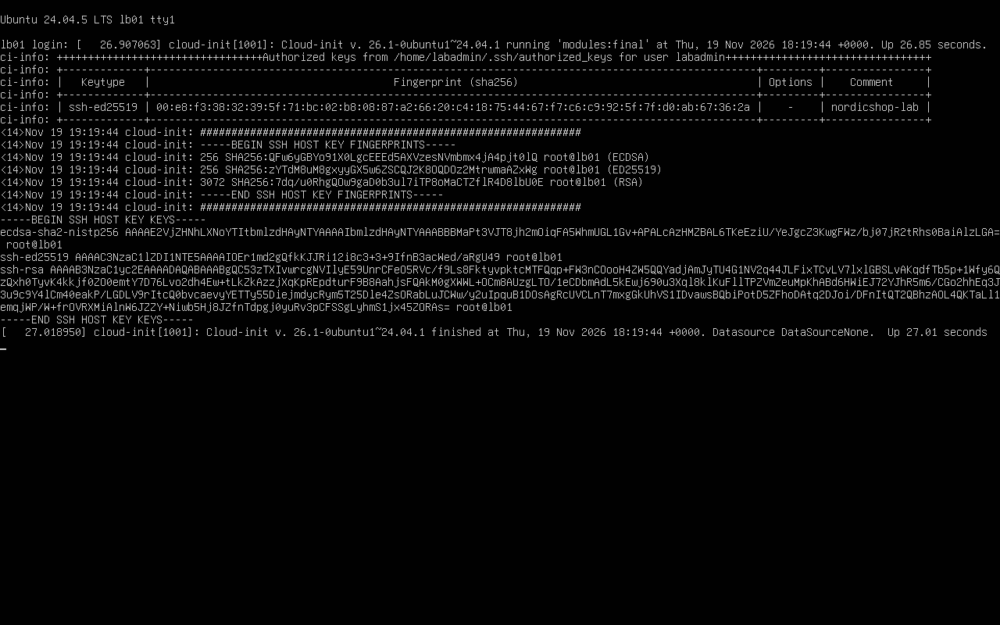
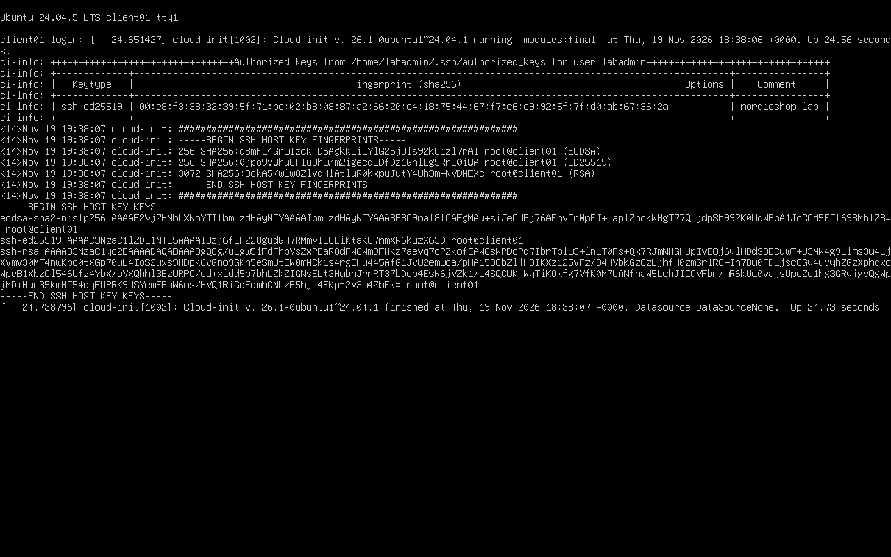
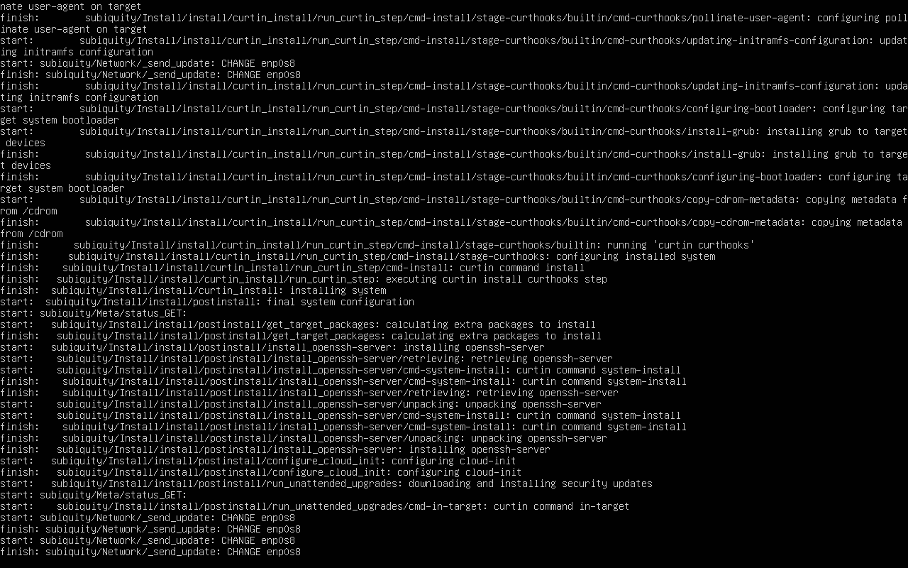
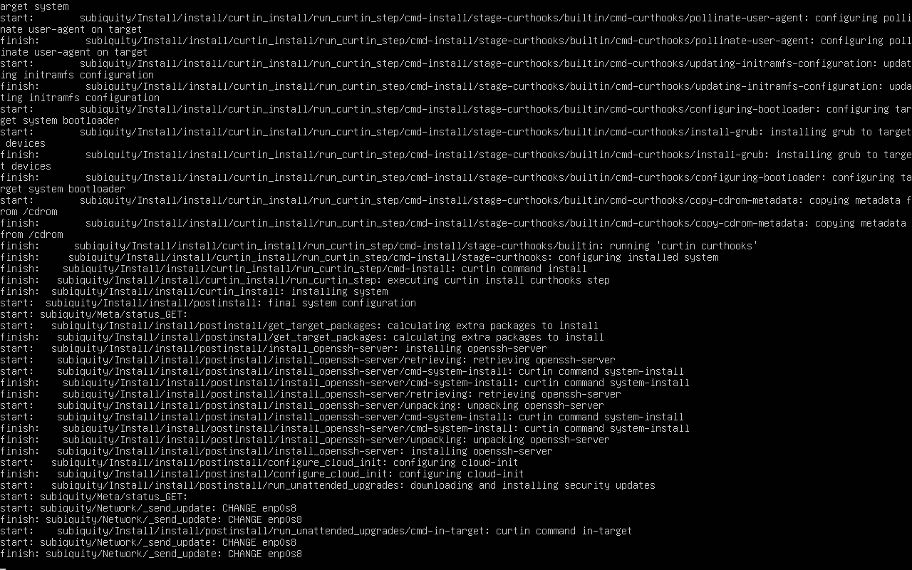
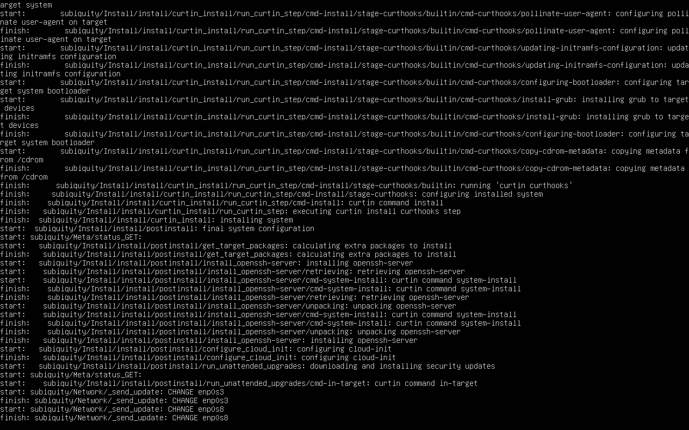
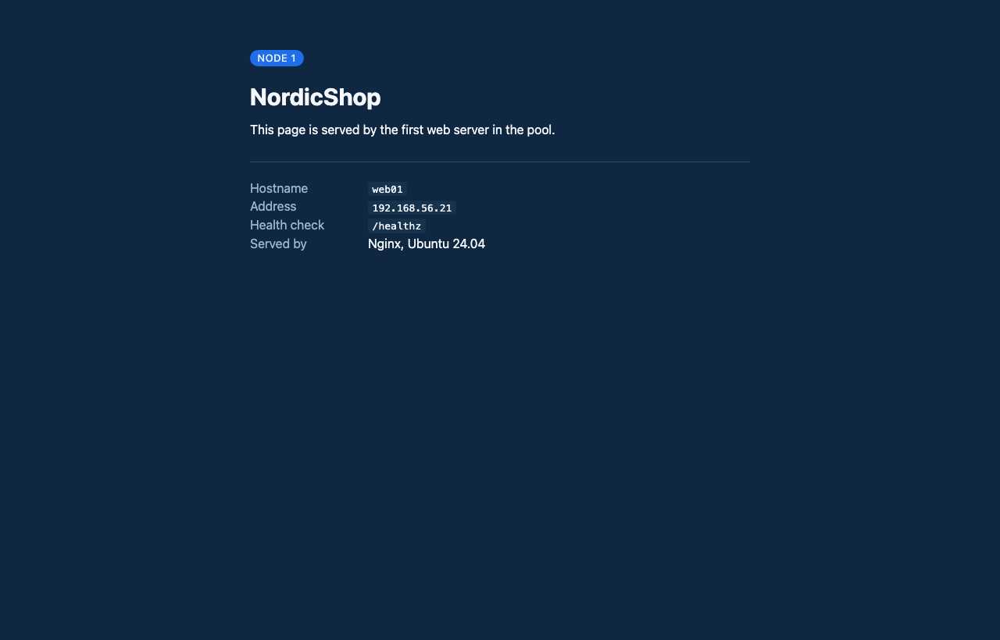

# Azure Load Balancer High Availability Lab

I built this lab to answer a question I kept running into in AZ-700 material: what does
a load balancer actually do when a backend fails, and how would I know? Reading about
health probes and probe thresholds is not the same as watching a pool go from `UP` to
`DOWN` in a second and a half while a client keeps getting `200`s.

So NordicShop is a small four-VM environment on VirtualBox: one HAProxy load balancer,
two Nginx backends, one client. I then broke it five different ways on purpose, recorded
what actually happened with timestamps and counters, and wrote each one up as an incident
report. Every number in this repository came out of a terminal on the machine, not out of
a slide.

It is a local simulation of an Azure Load Balancer, NSG and health-probe design, built
with the closest on-premises equivalents so the failure modes are real rather than
described.

## What this is not

- **Not an Azure deployment.** I created no Azure resources and spent nothing. The Azure
  mapping in `documentation/phase-5-azure-mapping.md` is a translation of this lab into
  Azure terms, and it says clearly which statements are measured here and which are how
  the managed service is defined to behave.
- **Not a production design.** One vCPU and 1 GiB per node, thin disks, a 192.168.56.0/24
  host-only network. It is sized to be teachable and disposable, not fast.
- **Not finished.** Keepalived and VRRP are designed in the Incident 4 report but not
  built, because a four-VM lab with one client cannot honestly demonstrate a VIP
  election. I would rather say that than pretend.

## Architecture

```
        Mac host (VirtualBox)
        LabNet 192.168.56.0/24
                 |
   +-------------+-------------+-------------+
   |             |             |             |
 client01       lb01         web01         web02
 .31            .10           .21           .22
              HAProxy        Nginx         Nginx
              :80 :8404      :80           :80
                 |             ^             ^
                 +-------------+-------------+
                   HTTP health check GET /healthz
```

Every guest has two NICs. NIC1 is NAT (`10.0.2.0/24`) and exists only so packages can be
installed; NIC2 is the host-only lab network and carries all lab traffic with static
addresses. Only NIC1 has a default route, which means the lab network can never route
traffic off the host by accident.

### IP plan

| Host | Role | Lab address (NIC2) | NAT address (NIC1) | Listening |
| --- | --- | --- | --- | --- |
| `lb01` | HAProxy 2.8 frontend + stats | 192.168.56.10 | 10.0.2.15 | 80, 8404 |
| `web01` | Nginx, node 1 | 192.168.56.21 | 10.0.2.15 | 80 |
| `web02` | Nginx, node 2 | 192.168.56.22 | 10.0.2.15 | 80 |
| `client01` | test client | 192.168.56.31 | 10.0.2.15 | none |
| host `LabNet` | VirtualBox host-only (`bridge100`) | 192.168.56.1 | n/a | n/a |

All four guests show the same NAT address because each VM has its own isolated VirtualBox
NAT network, and `10.0.2.15` is the first address in each of them. That address is only
used for outbound package installation, so sharing it is harmless, but it does mean it
identifies nothing: when I look at a log line from `10.0.2.15` I cannot tell which guest
produced it.

Firewall boundaries, which matter for two of the incidents:

- `web01` and `web02` accept port 80 **only from 192.168.56.10**. Nothing else reaches
  the backends directly, including the client and the host.
- SSH is allowed from the lab subnet and from `10.0.2.0/24`.
- HAProxy binds both sockets to `192.168.56.10`, not `0.0.0.0`, so it is not exposed on
  the NAT interface.

### Versions

```
Ubuntu Server 24.04.5 LTS   guest OS, cloud-init autoinstall
HAProxy 2.8.30              load balancer on lb01
Nginx 1.24.0                backends
VirtualBox 7.2.14           host hypervisor, macOS
```

## What it looks like

Screenshots of each stage, taken from the running lab. I captured them with headless Chrome
pointed at `192.168.56.10`, so the browser frame is mine and everything inside it is the
real pool answering at that moment.

### The four VMs

Every guest has its own console, and those consoles carried information the host could not
give me. Two of them came up cleanly. The other two stalled, and that is the part worth
showing.

First the host's own view, so the names in the pictures below line up with the machines in
the lab: four registered VMs, four green arrows. I cropped the window down to the lab
machines, because the same VirtualBox library holds other work that is not part of this
project.


`lb01` finished cloud-init at 18:19:44, printed the `nordicshop-lab` key it had installed
for `labadmin`, and dropped to a login prompt.



`client01` did the same at 18:38:06. That `client01 login:` line is how I confirmed the
guest had come up with the hostname I asked for, rather than with something the installer
made up.



`web01` and `web02` never got that far on the first attempt. Both stopped on the same line,
`run_unattended_upgrades`, which runs `apt-get dist-upgrade` inside the target system and
prints nothing while it runs.





### How the installs failed, and how I got past them

This is the part of the build that cost me the most time, so it goes in the order it
happened.

The first attempt failed loudly. The installer worked through network, mirror and locale,
then stopped with:

```
curtin command in-target returned non-zero exit status 1
An error occurred. Press enter to start a shell
```

I took that shell and checked the obvious thing first: the network. The archive answered a
ping in 37 ms, so connectivity was never the problem. What the shell did show was that
`/etc/resolv.conf` named no server, and that `/target` had already been torn down, so the
failing `apt-get update` could not be re-run to read its own error.


The cause was the resolver. The installer resolves through systemd-resolved's stub on
`127.0.0.53`, and inside the target chroot during `curtin in-target` there is nothing
behind that stub, so apt could not resolve the archive even though the installer
environment could. The fix was to write a real resolver before the target gets configured,
so curtin copies a working one into the chroot:

```yaml
early-commands:
  - sh -c 'printf "nameserver 10.0.2.3\nnameserver 1.1.1.1\n" > /etc/resolv.conf'
```

`10.0.2.3` is VirtualBox's own NAT DNS service. With that in place the same stage completed
and curtin moved on to packages, kernel and bootloader.

The second attempt failed quietly, which was worse. Three guests sat in the final stage for
between 20 and 50 minutes without an error. The host made it look like work was happening:
`VBoxHeadless` was holding 112% of a CPU. The disk disagreed. The VDI was 3927 MB, and it
was still 3927 MB seventy-five seconds later, so nothing was being written to it.



I never pinned that one down conclusively, and
`troubleshooting/install-autoinstall-failures.md` says so instead of inventing a cause.
What I did instead was use what the installer had already produced: kernel, bootloader,
cloud-init and OpenSSH were all on disk. So I powered each guest off, detached both ISO
images, set the disk as the first boot device and started it again.

```bash
VBoxManage controlvm nordicshop-lb01 poweroff
VBoxManage storageattach nordicshop-lb01 --storagectl SATA --port 1 --device 0 \
  --type dvddrive --medium none
VBoxManage storageattach nordicshop-lb01 --storagectl SATA --port 2 --device 0 \
  --type dvddrive --medium none
VBoxManage modifyvm nordicshop-lb01 --boot1 disk --boot2 none
VBoxManage startvm nordicshop-lb01 --type headless
```

That worked on all of them. Both NICs came up with their static addresses, `dpkg --audit`
printed nothing, and key authentication worked. The same report covers the three other
provisioning failures: the readiness check that passed before sshd existed, the rejected
`identity` section, and the autoinstall confirmation prompt that had to be answered by
injecting keystrokes into the console.

### The two web nodes

Both backends serve the same page with the node identity baked into it, so any screenshot
says which one answered. These are two separate requests through the balancer, one
round-robin step apart.



`NODE 1`, `web01`, `192.168.56.21`.


`NODE 2`, `web02`, `192.168.56.22`. Same URL, different server, and the client never chose.

### The load balancer's view of the pool

HAProxy's stats page on port 8404 is the closest thing this lab has to a dashboard, and it
is what I watched during every incident.


Both servers green, `Status UP`, `LastChk L7OK/200`, equal weight on `nordicshop_web`.
That bottom line is the state I expect to see before I break anything.

### A failure, caught while it was happening

I re-ran Incident 1 for this image: stopped Nginx on web01, waited three seconds, captured
the stats page, then started Nginx again.


`web01` is red with `L4CON in 2ms`, a downtime timer of three seconds and a growing queue;
`web02` is untouched and still `UP`. The frontend row stays `OPEN` throughout, which is the
whole point of the incident: the pool lost half its capacity and the customer saw `200`s.

### What is not screenshotted

Incidents 2, 3 and 5, and the total outage in Incident 4, are recorded as measured terminal
output in their reports. For Incident 4 I tried to capture the browser's connection error
and could not: headless Chrome exits cleanly on a failed navigation without writing an
image. Rather than fake that frame, the outage stays a table of 33 failed requests.

## The five incidents

Each one was run with samplers capturing the client's view and the pool's view at the
same time, so the reports contain real timelines rather than reconstructions.

| # | What I broke | Detection | Customer impact |
| --- | --- | --- | --- |
| 1 | Stopped Nginx on web01 | **~1.5 s** | 0 of 120 requests failed (98 to web02, 22 to web01) |
| 2 | Blocked lb01 to web01:80 with a firewall rule | **~9.3 s** | 3 of 80 requests failed |
| 3 | Pointed web01's health check at port 8080 | **~2.4 s** after reload | 0 of 60 requests failed, capacity halved |
| 4 | Stopped the load balancer itself | no detection, **~34 s outage** | 33 of 33 requests failed |
| 5 | Sent keep-alive traffic through a Layer 4 frontend | n/a | none: 10 of 10 requests pinned to one node |

### The scenario behind each one

The table is the summary. This is what I did, what I saw, and what put it back.

1. **I stopped Nginx on web01.** The client never noticed: 0 of 120 requests failed. The
   pool noticed in 1.5 seconds with `L4CON` and `check duration: 0ms`, because the kernel
   refused the connection immediately rather than dropping it. Recovery was
   `systemctl start nginx` and nothing else, no reload and no config change; HAProxy logged
   `L7OK/200` and the node was `UP` about a second later. The reason no customer saw an
   error is `option redispatch`, which retried the 22 requests that had landed on the dead
   node against web02.
2. **I blocked lb01 to web01:80 with a ufw rule.** The client did notice this time: 3 of
   80 requests hung until their own timeout. The pool showed `Layer4 timeout` with
   `check duration: 2000ms`, so detection stretched to 9.3 seconds instead of 1.5, and the
   two frontends left web01 in the same state they would after a crash. The fix was
   `ufw delete deny from 192.168.56.10 to 192.168.56.21 port 80 proto tcp`; the path came
   back and the balancer found it on its own about 3.5 seconds later, with no HAProxy or
   Nginx restart.
3. **I pointed web01's check at port 8080.** Nginx was serving `200` on port 80 the whole
   time, and `haproxy -c` said the config was valid, but the pool removed the node 2.4
   seconds after the reload because nothing listened on the port the check used. Customers
   saw nothing: 0 of 60 samples failed, and capacity simply halved. The fix was to copy the
   saved config back over `/etc/haproxy/haproxy.cfg` and reload. The node itself was never
   touched, which was the point: only the observer was wrong.
4. **I stopped the load balancer.** With no probe able to detect a dead frontend, the
   client got `000` and curl exit 7 on all 33 requests for about 34 seconds. `systemctl
   start haproxy` restored service in seconds, but that is a recovery and not a fix, and
   the report says so. The actual fix is the keepalived and VRRP pair designed in
   `troubleshooting/incident-04-load-balancer-failure.md`: two balancers, one shared VIP, an
   election between them. It is designed and not built, because a single client cannot
   honestly demonstrate an election.
5. **I forced keep-alive traffic through a Layer 4 frontend.** Same 10 requests that had
   split 5/5 in `mode http` all went to web01 over one connection, with `sessions=1` and
   `req_tot` blank, because a Layer 4 balancer chooses per connection and cannot count
   requests. Nothing failed and no user was affected, which is exactly why it is worth
   keeping: the dashboard looked healthy while one node did all the work. The fix was to
   remove the temporary frontend and restore `balance roundrobin`, and the report keeps the
   decision table for the cases where Layer 4 is the right answer anyway.

### What each one actually taught me

1. **A stopped process fails fast and gets masked.** HAProxy logged `Connection refused`
   with `check duration: 0ms` and logged the server DOWN at 1.5 seconds. Every client
   request still got a `200` because `option redispatch` retried in flight: 22 requests
   that were assigned to the dead node came back from web02. That means a monitoring
   system watching HTTP status codes would have missed the whole incident.
2. **A dropped packet looks nothing like a refused one.** With the firewall dropping
   traffic, the check reported `Layer4 timeout` and `check duration: 2000ms`, detection
   stretched to 9.3 seconds, and customers saw three requests hang until their own
   timeout. Same pool state, completely different fingerprint.
3. **The balancer's opinion is not the backend's health.** A healthy Nginx, reachable on
   port 80 from the balancer, returning `200` locally, was removed from the pool in 2.4
   seconds because the check was aimed at port 8080. `haproxy -c` had already said
   `Configuration file is valid`. Configuration validation is not behavioural validation.
4. **Redundancy has to reach the edge.** Two healthy backends, an idle balancer, and a
   totally dead site: `000` and curl exit 7 on every request for 34 seconds. The backends
   answered `200` throughout, from the balancer's host and from themselves. All the
   availability work sat below the one component that had none.
5. **Even distribution is a property of the balancing key.** In HTTP mode the lab
   balances per request, and keep-alive did not pin anything: 1 connection, 10 requests,
   5/5. Forcing a Layer 4 frontend pinned all 10 requests to web01, with
   `sessions=1` and `req_tot` blank. `balance source` split three clients 16 to 10
   sessions by hashing two of them to the same node. Connection counts and request counts
   are different quantities, and which one you watch decides whether you notice.

The fifth one also produced the most useful surprise: I chose `mode http` in Phase 4 only
so the health check could request `/healthz`, and that choice happens to be what prevents
keep-alive from pinning clients here. I did not know that when I made the decision.

## Repository map

### Documentation

| File | Contents |
| --- | --- |
| `documentation/phase-1-environment-assessment.md` | Host capacity, VirtualBox and VT-x checks, VM sizing and why |
| `documentation/phase-2-network.md` | VM creation, cloud-init provisioning, static addressing, ping matrix |
| `documentation/phase-3-web-tier.md` | Nginx deployment, distinct node identity, firewall boundary proven both ways |
| `documentation/phase-4-load-balancer.md` | HAProxy config, health checks, algorithm choice, distribution evidence |
| `documentation/phase-5-azure-mapping.md` | The lab translated into Azure LB, NSG and probe terms, incident by incident |

### Architecture

| File | Contents |
| --- | --- |
| `architecture/architecture-diagram.md` | Traffic paths, failure domains, what is redundant and what is not |
| `architecture/ip-addressing-plan.md` | Full address plan, netplan config, port table, Azure overlay |

### Incident reports

| File | Incident |
| --- | --- |
| `troubleshooting/incident-01-backend-failure.md` | Backend process stopped: fast failure, redispatch, 1.5 s |
| `troubleshooting/incident-02-network-failure.md` | Path blocked by firewall: silent drop, 9.3 s, customer timeouts |
| `troubleshooting/incident-03-health-check-port.md` | Wrong probe port: healthy node removed, 2.4 s |
| `troubleshooting/incident-04-load-balancer-failure.md` | Balancer stopped: total outage, keepalived/VRRP design, Azure comparison |
| `troubleshooting/incident-05-uneven-distribution.md` | Keep-alive pinning, `balance source`, why counters disagree |
| `troubleshooting/install-autoinstall-failures.md` | Five provisioning failures and how I fixed each one |

### Configuration (what actually runs)

| Path | Contents |
| --- | --- |
| `configuration/haproxy/haproxy.cfg` | Frontend, backend, probe, timeouts, stats listener |
| `configuration/nginx/web01-site.conf`, `web01-index.html` | Node 1 server block and page |
| `configuration/nginx/web02-site.conf`, `web02-index.html` | Node 2 server block and page |
| `configuration/autoinstall/user-data.tmpl`, `meta-data.tmpl` | cloud-init NoCloud templates |

### Scripts

| Script | Purpose |
| --- | --- |
| `scripts/rebuild-lab-vms.sh` | Create the four VMs. Prints the plan unless `CONFIRM=yes`; `BACKUP=yes` keeps the old folders |
| `scripts/install-guest.sh <host> <ip>` | Build the seed ISO, attach both ISOs, run the autoinstall, wait for SSH |
| `scripts/build-seed-iso.sh <host> <ip>` | Standalone seed ISO builder (`/tmp/nordicshop-seed-<host>.iso`) |
| `scripts/finish-guest.sh <host> <ip>` | Eject media, boot from disk, verify the guest answers with its hostname |
| `scripts/guest.sh <host> [--root] "<cmd>"` | SSH wrapper; base64-encodes the remote command, feeds sudo over stdin |
| `scripts/deploy-nginx.sh <host>` | Install the site config and page from `configuration/nginx/` |
| `scripts/deploy-haproxy.sh` | Validate then deploy `haproxy.cfg`, keeping a timestamped backup |
| `scripts/verify-web-tier.sh` | Prove the backend firewall boundary in both directions |
| `scripts/verify-load-balancing.sh [n]` | Send `n` requests and count which node answered, plus pool state |
| `scripts/probe-frontend.sh [n] [interval]` | Client-side sampler used during incidents |
| `scripts/watch-pool.sh [n] [interval] [server]` | Pool-state sampler |
| `scripts/watch-pool-timeline.sh` | Pool sampler that survives a reload or crash |
| `scripts/pool-counters.sh [pxname]` | Sessions vs requests per server, columns resolved by name |

### Screenshots

`screenshots/` holds real captures only: a console for each of the four VMs, the
installer stall, the recovery shell from the apt failure, and the running lab from the
section above. The browser screenshots were taken with headless Chrome; the console ones
are frames of the VirtualBox display. Nothing in there was recreated.

## Rebuilding the lab

### Prerequisites

- VirtualBox 7.x on the host, with a host-only network named `LabNet` on
  `192.168.56.0/24` (this lab reuses an existing one; it does not create or modify host
  networks)
- Ubuntu Server 24.04 live ISO, by default expected at
  `~/Downloads/ubuntu-24.04.5-live-server-amd64.iso` (override with `ISO=`)
- About 4 GB RAM and 80 GB disk free for the four VMs
- `.secrets/` containing the lab account details and SSH key. It is gitignored and
  deliberately not in this repository:

```
.secrets/lab.env        LAB_USER=labadmin, LAB_PASS_FILE=...
.secrets/lab.pass       the account password
.secrets/lab_ed25519    private key
.secrets/lab_ed25519.pub
```

### Steps

```bash
# 1. create the four VMs (destructive: prints a plan first)
./scripts/rebuild-lab-vms.sh
CONFIRM=yes BACKUP=yes ./scripts/rebuild-lab-vms.sh

# 2. install each guest from the cloud-init seed, one at a time
./scripts/install-guest.sh lb01     192.168.56.10
./scripts/install-guest.sh web01    192.168.56.21
./scripts/install-guest.sh web02    192.168.56.22
./scripts/install-guest.sh client01 192.168.56.31

# 3. switch each guest from installer boot to disk boot and verify it
./scripts/finish-guest.sh lb01     192.168.56.10
./scripts/finish-guest.sh web01    192.168.56.21
./scripts/finish-guest.sh web02    192.168.56.22
./scripts/finish-guest.sh client01 192.168.56.31

# 4. deploy the tiers
./scripts/deploy-nginx.sh web01
./scripts/deploy-nginx.sh web02
./scripts/deploy-haproxy.sh

# 5. verify: firewall boundary, then distribution
./scripts/verify-web-tier.sh
./scripts/verify-load-balancing.sh 20
```

Expected result of step 5: the firewall matrix passes in both directions (denials time
out at 5.00 s, which is a DROP rather than a refusal), and the 20 requests split 10/10
with both servers `UP`, `check=L7OK`, `code=200`.

The provisioning path has real failure modes, all documented in
`troubleshooting/install-autoinstall-failures.md`: the unattended installer spinning in
`run_unattended_upgrades`, the "Continue with autoinstall?" prompt that has to be answered
on the console, `policy-rc.d` leaving services installed but inactive, and `nc -z`
reporting success against VirtualBox's NAT forward with no guest behind it.

## Azure: what the managed service removes, and what it does not

This is the part I would actually use in a design review.

**Azure removes:**

1. The load balancer as a single point of failure. No VM to stop, no keepalived to build,
   zone-redundant frontend, 99.99% SLA on Standard SKU.
2. VIP failover engineering. The 34-second total outage in Incident 4 has no equivalent.
3. Patching and hardening a balancer OS.
4. Probe state persistence across reloads.
5. Capacity planning for the balancer host.

**Azure does not remove:**

1. Probe misconfiguration (Incident 3). The portal will happily accept a probe port where
   nothing listens.
2. NSG priority-ordering mistakes (Incident 2). Silent drops, first match wins, rules on
   the subnet overriding rules on the NIC.
3. Backend single points of failure. A one-VM pool is not highly available because the
   front door is.
4. Request-level retry (Incident 1). Azure LB is flow-based: it cannot redispatch a
   request the way HAProxy did. My zero-error result was a Layer 7 feature.
5. Fast detection. Azure's probe interval floor is 5 seconds, so the same backend failure
   takes about 10 seconds to notice at threshold 2, against the 1.5 seconds measured
   here. Defaults make it 30 seconds.
6. Traffic imbalance (Incident 5). 5-tuple hashing and Client IP persistence are the same
   trade-offs as `mode tcp` and `balance source`, and Layer 4 metrics count flows, not
   requests.

The short version: the managed service takes over the availability of the balancer
itself, and leaves you owning the probe, the firewall rules, the pool, and the balancing
key. Those four are exactly what the five incidents are about.

## Deliberate deviations

- **`mode http` instead of the `mode tcp` in the original brief.** HTTP mode lets the
  probe request `/healthz` and assert a 200 instead of only proving that a socket
  accepts connections. The TCP equivalent and the trade-off are written up in
  `documentation/phase-4-load-balancer.md`, and Incident 5 shows an unexpected second
  benefit: per-request balancing.
- **Rebuilding the VMs rather than patching them.** The first build was unreliable
  enough (see the install failure report) that a clean rebuild with a scripted cloud-init
  seed was faster than repairing each guest by hand. The old `lb01` disk was backed up
  outside the repository before deletion.
- **`balance source` documented, not chosen.** It would have made a single test client
  look like a healthy, even deployment while hiding a node failure, which is the opposite
  of what a lab should demonstrate.

## Where I would take it next

- Build the keepalived + VRRP pair properly, with a second load balancer and a VIP, and
  measure the actual failover time instead of quoting a design.
- Add a fifth incident that combines two failures at once, because real outages rarely
  arrive one at a time.
- Repeat the probe timing on a larger node count to see where `leastconn` starts to beat
  `roundrobin`.

---

Built and measured on macOS with VirtualBox, November 2026. Every command, counter and
timestamp in these documents came from the running lab; where something was not tested,
the document says so.
