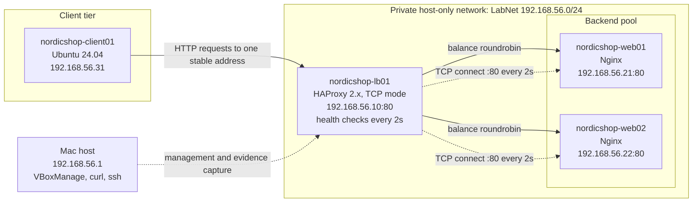

# Architecture

**Project:** NordicShop highly available load balancing lab
**Version:** 1.0, proposed
**Status:** pending approval before implementation

## 1. Before: the current NordicShop platform

A single Linux server runs Nginx and the shop application. Everything depends on it.

```
        Internet
            |
      [ Public IP ]
            |
   +--------+---------+
   |  nordicshop-web  |   single Linux server
   |  Nginx + shop    |
   |  CPU 90% at peak |
   +------------------+
            |
     single point of failure:
     reboot for patching = outage
     disk or process failure = outage
     traffic spike = slow or unavailable
```

Symptoms the business reports: slow response during campaigns, high CPU, outages during
maintenance windows, and no automatic way to route around a failed server.

## 2. After: the proposed lab architecture



Dotted lines are health checks, not application traffic. Keeping them visually separate makes
it obvious that a health check failure removes a server from the pool without touching the
request path of a healthy one.

## 3. Request flow

1. The client sends `GET http://192.168.56.10/` to the load balancer.
2. HAProxy accepts the TCP connection on its frontend, bound to 192.168.56.10:80.
3. HAProxy picks a backend from the pool according to the configured algorithm.
4. HAProxy opens a TCP connection to that backend and relays bytes in both directions.
5. The backend answers. The client sees the load balancer's address, never the backend's.
6. Every two seconds, HAProxy independently probes port 80 on both backends.

Because the frontend is a single stable address, the client configuration never changes when
backends are added, removed or fail.

## 4. Failure domains

| Component | If it fails | Customer impact in this lab | Impact in a real design |
| --- | --- | --- | --- |
| web01 | Health check fails within seconds, traffic moves to web02 | None after the check interval | None with at least two healthy members |
| web02 | Same, traffic moves to web01 | None | None |
| Both backends | No healthy member, HAProxy returns an error | Outage | Redundancy must cross availability zones |
| lb01 | All traffic stops. This is the single point of failure | Total outage | Needs a second load balancer or a managed service |
| Network path to a backend | Health check fails, backend removed | None | None |

The load balancer itself is the weakness in this first design. Fixing it properly means two
HAProxy nodes with a floating virtual IP (keepalived and VRRP), or moving to a managed service
where availability of the balancer is part of the contract. That trade-off is covered in
Azure mapping and in the Incident 4 write-up.

## 5. Why these components

| Choice | Reason |
| --- | --- |
| HAProxy in TCP mode | Layer 4 forwarding is what Azure Load Balancer does, so the local model matches the cloud model. Layer 7 would be a better fit for a future Azure Application Gateway comparison |
| Nginx backends | Lightweight, installs from the Ubuntu repositories, and a static page makes it trivial to prove which backend answered |
| Separate client VM | Traffic must originate somewhere independent of the balancer, and it demonstrates that the client only ever knows one address |
| Host-only network | Traffic never leaves the laptop. Nothing in this lab touches the home or office network |
| Two NICs per guest | NAT for `apt`, host-only for lab traffic. Same separation as a management path versus an application subnet in Azure |

## 6. Azure equivalent of this diagram

```
                         Internet
                             |
                   +---------+----------+
                   |  Public IP address |      created by you, owned by the platform
                   +---------+----------+
                             |
        +--------------------+---------------------+
        |  Azure Standard Load Balancer (Layer 4)  |   managed service, HA built in
        |  frontend IP config   + health probes    |
        +---------+----------------------+---------+
                  |                      |
        +---------+--------+    +--------+---------+
        |  VM web01        |    |  VM web02        |   you patch, you monitor
        |  10.20.1.4       |    |  10.20.1.5       |
        |  Nginx           |    |  Nginx           |
        +------------------+    +------------------+
                  \                      /
                   \____ same VNet _____/
                     subnet 10.20.1.0/24
                     NSG on subnet or NIC
```

The local lab maps one to one onto this: frontend address, backend pool, health probe,
distribution algorithm, and a firewall rule that only admits the balancer. What changes is
who operates the balancer itself.
